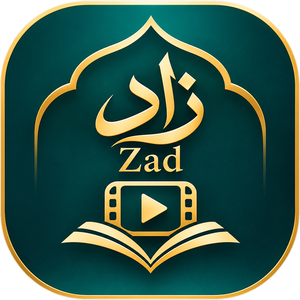

<p align="center"></p>

# Zad: Quran Status & Video Maker

Make Quran videos in the browser — nothing is uploaded anywhere.

- **Shorts / Reels** (default): 9:16, 1:1 or 16:9 clips of up to 20 ayat over a gradient, picture, video or
  slideshow, with the recitation of your chosen reciter. For statuses, stories and reels.
- **Long video** («فيديو طويل»): 1920×1080 (16:9) TV-style videos of any range, up to a whole surah, on
  14 templates (10 painted backgrounds with the surah and reciter written into their plates, 4 ornament
  templates that work over any background). Long ayat shrink to fit and split into pages.

Both tabs: stroke + glow / glow / shadow / none text effect with a choice of glow and shadow colour, text
colour and size, the user's own pictures and videos as backgrounds (kept on the device), the Quran text in the
King Fahd Complex Hafs script, 42 reciters (everyayah.com), five interface languages (ar, en, tr, ur, ckb).

## Run it

It is a static site — no build step.

```bash
npm install          # only needed for the tests
npm start            # http://localhost:8080  (any static server works: python3 -m http.server)
```

Open `http://localhost:8080/` (it redirects to `pages/video-maker.html`). Use a secure origin
(`localhost` or https) — WebCodecs and the service worker need one.

## How the fast export works (long video)

A long video is not recorded in real time:

1. Everything that never changes (background, ornaments, name plates, logo) is drawn once into a base layer, and
   each ayah page is drawn once into its own text layer, so Arabic is never re-shaped per frame.
2. Frames are encoded with **WebCodecs** (H.264) and written with [mp4-muxer](https://github.com/Vanilagy/mp4-muxer)
   (`js/vendor/mp4-muxer.js`, MIT): full frame rate only during the short fades, one frame a second while the
   picture holds still.
3. The recitation is fetched, decoded and encoded one ayah at a time, so memory stays flat however long the range is.

Measured with software encoding: a 35-minute video in about 77 s. Audio is AAC where the browser can encode it,
Opus-in-MP4 otherwise. Browsers without WebCodecs fall back to real-time recording (as long as the video itself,
and the Shorts tab always works that way).

## Project layout

| Path | What |
|---|---|
| `pages/video-maker.html` | the page |
| `js/video-maker.js` | the Shorts tab, the shared pickers, data and text drawing |
| `js/video-maker-long.js` | the Long video tab: layout, caching, preview, fast export |
| `js/tv-templates.js` | the template registry (positions are percentages of the 16:9 frame) |
| `js/vendor/mp4-muxer.js` | MP4 writer (MIT) |
| `images/tv-maker/` | long-video pictures — see its [README](images/tv-maker/README.md) |
| `images/video-maker/` | Shorts backgrounds; `npm run bgs` rebuilds `manifest.json` after adding files |
| `data/quran.json`, `data/quran-qpc.json` | Quran text (see below) |
| `sw.js` | offline support |
| `tools/` | the scripts that cut the ornament sheets into separate pieces (needs Python + Pillow) |
| `tests/` | Playwright tests (`npm test`; set `PW_CHROMIUM` to use an installed Chromium) |

### Add a template

Add an entry to `js/tv-templates.js`. A *painted* template is one call to `painted(id, ar, en, file, topPlate,
bottomPlate, options)` with the picture in `images/tv-maker/backgrounds/` and the inside of its two plates in
percent (left, top, right, bottom). An *ornament* template lists ornaments, plates and text boxes. Then add the
picture to `sw.js` only if you want it precached (everything is cached on first use anyway) and bump `VERSION`.

## Data and credits

- Quran text: Uthmani script, Hafs 'an 'Asim, identical letter for letter to the Tanzil Uthmani text; `data/quran.json`
  with the King Fahd Complex (QPC Hafs) encoding in `data/quran-qpc.json`, checked against it when the page loads.
- Recitations are streamed from [everyayah.com](https://everyayah.com).
- [mp4-muxer](https://github.com/Vanilagy/mp4-muxer) by Vanilagy, MIT.
- Ornaments and painted backgrounds: supplied for the project.

## License

MIT — see [LICENSE](LICENSE). The Quran text, the recitations, the fonts and the pictures each keep their own terms.
